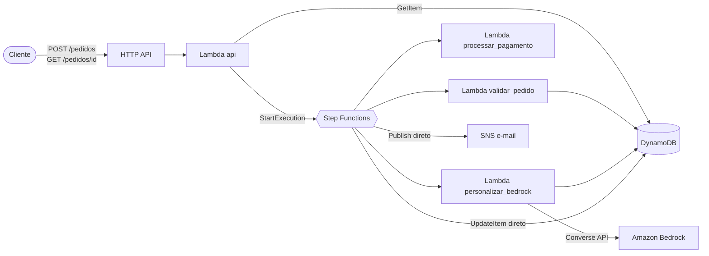

# Assistente de Delivery

Orquestração do ciclo de vida de um pedido de delivery com **AWS Step Functions**, com mensagens personalizadas para o cliente geradas pelo **Amazon Bedrock**.

> **Protótipo de estudos.** Este projeto foi feito para praticar arquitetura serverless na AWS e não está publicado em nenhuma conta. Todo o código, a máquina de estados e o template de infraestrutura foram validados localmente (`pytest`, `sam validate --lint` e `sam build`). A seção [Deploy (opcional)](#deploy-opcional) mostra como subir numa conta própria, se quiser.

  

## O problema

Um pedido de delivery passa por várias etapas que podem falhar de jeitos diferentes: dados errados, cartão recusado, gateway de pagamento fora do ar, serviço de IA instável. Cada falha precisa de um tratamento diferente: algumas cancelam o pedido, outras merecem uma nova tentativa, e outras não podem travar nada.

Colocar tudo isso numa função só vira um emaranhado de `if` e `try`. Aqui o fluxo fica numa **máquina de estados**: cada etapa é pequena e testável, e as regras de retry, cancelamento e fallback ficam declaradas e visíveis num grafo.

## Arquitetura



**Fluxo do pedido:**

1. **ValidarPedido**: valida campos, CEP e e-mail, e calcula o total. Se o pedido estiver inválido, ele é cancelado.
2. **ProcessarPagamento**: usa um gateway simulado. Pagamento recusado cancela o pedido, e um timeout faz o passo tentar de novo.
3. **PersonalizarBedrock**: gera uma mensagem para o cliente e sugestões de itens. Se a IA falhar, o pedido segue com uma mensagem padrão.
4. **AtualizarStatus** e **NotificarCliente**: gravam no DynamoDB e enviam pelo SNS direto da Step Function, sem Lambda.
5. **Entrega simulada**: `PREPARANDO` → `SAIU_PARA_ENTREGA` → `ENTREGUE`, com estados `Wait` entre eles.

O diagrama completo da máquina de estados, a tabela de erros e o modelo de dados estão em [docs/arquitetura.md](docs/arquitetura.md).

## Decisões técnicas

| Decisão | Por quê |
|---|---|
| **Step Functions Standard** | Fluxo longo (com esperas), auditável e com histórico de cada execução no console. |
| **Integração direta com DynamoDB e SNS** | Atualizar status e mandar e-mail não precisa de código. Sem Lambda nesses passos, há menos coisa para manter e pagar, e menos cold start. |
| **Retry só em erro transitório, Catch em erro de negócio** | Timeout do gateway vale uma nova tentativa (backoff 2s, 4s, 8s). Cartão recusado não, então vai direto para o cancelamento. |
| **A IA nunca derruba o pedido** | Há duas camadas de proteção. A Lambda valida o JSON do modelo e usa uma mensagem padrão se algo vier errado. Se a própria Lambda falhar, um `Catch` na Step Function faz o mesmo. |
| **`Decimal` para dinheiro** | O DynamoDB não aceita `float`, e `float` erra centavos (`0.1 + 0.2 != 0.3`). |
| **Pedido gravado como `RECEBIDO` antes de validar** | Mesmo pedidos inválidos ficam registrados com o motivo do cancelamento. |
| **`ResultPath` em todos os estados** | Cada etapa adiciona o seu resultado sem apagar o payload original. |
| **HTTP API em vez de REST API** | Mais barata e mais simples para duas rotas. |
| **IAM de menor privilégio** | Cada Lambda só acessa o que usa. O Bedrock só pode invocar o modelo configurado, e o pagamento simulado não tem permissão nenhuma. |
| **Lambdas em arm64 (Graviton)** | Cerca de 20% mais barato, sem mudar nada no código. |

## Stack

Python 3.12 · AWS SAM · Step Functions · Lambda · DynamoDB (on-demand) · Amazon Bedrock (Converse API) · API Gateway (HTTP API) · SNS · CloudWatch Logs · X-Ray · pytest + moto

## Estrutura

```
├── template.yaml              # infraestrutura (SAM)
├── statemachine/
│   └── delivery.asl.json      # máquina de estados (ASL)
├── src/
│   ├── shared/errors.py       # exceções de negócio
│   ├── validar_pedido/
│   ├── processar_pagamento/
│   ├── personalizar_bedrock/
│   └── api/
├── tests/unit/                # um arquivo de teste por lambda
├── events/                    # payloads dos 4 cenários
└── docs/arquitetura.md
```

## Como rodar os testes

Requisitos: Python 3.12. Os testes não acessam a AWS: o DynamoDB é simulado com `moto` e o Bedrock com `unittest.mock`.

```bash
python -m venv .venv
source .venv/bin/activate        # Windows: .venv\Scripts\activate
pip install -r requirements-dev.txt
pytest --cov=src --cov-report=term-missing
```

```
19 passed
src/api/app.py                    100%
src/personalizar_bedrock/app.py   100%
src/processar_pagamento/app.py    100%
src/validar_pedido/app.py          92%
TOTAL                              97%
```

Para validar a infraestrutura (precisa do [SAM CLI](https://docs.aws.amazon.com/serverless-application-model/latest/developerguide/install-sam-cli.html), sem conta AWS):

```bash
sam validate --lint
sam build
```

## Cenários

Os payloads ficam em [`events/`](events/). O resultado depende do token de pagamento:

| Arquivo | Token | Resultado |
|---|---|---|
| `pedido_aprovado.json` | `tok_teste_aprovado` | Pedido segue até `ENTREGUE` |
| `pedido_pagamento_recusado.json` | `tok_teste_recusado` | `CANCELADO` (pagamento recusado) |
| `pedido_invalido.json` | — | `CANCELADO` (CEP fora do formato) |
| `pedido_timeout.json` | `tok_teste_timeout` | Falha 2x, o retry recupera e o pedido segue até `ENTREGUE` |

### Request e response

`POST /pedidos` com o conteúdo de `events/pedido_aprovado.json`:

```json
{
  "pedido_id": "7b1e6c0a-2f4d-4e8b-9c1a-5d3f2e1b0a9c",
  "executionArn": "arn:aws:states:us-east-1:<conta>:execution:DeliveryStateMachine-...:7b1e6c0a-..."
}
```

`GET /pedidos/{id}` depois que a entrega termina:

```json
{
  "pedido_id": "7b1e6c0a-2f4d-4e8b-9c1a-5d3f2e1b0a9c",
  "status": "ENTREGUE",
  "total": "78.90",
  "mensagem_personalizada": "Oi Ana! Sua Margherita já vai pro forno, sem cebola como você pediu.",
  "sugestoes": ["Bruschetta de tomate", "Brownie vegano"],
  "historico_status": [
    { "status": "RECEBIDO", "em": "2026-11-06T21:00:00+00:00" },
    { "status": "VALIDADO", "em": "2026-11-06T21:00:00+00:00" },
    { "status": "PAGO", "em": "2026-11-06T21:00:03.512Z" },
    { "status": "PREPARANDO", "em": "2026-11-06T21:00:03.871Z" },
    { "status": "SAIU_PARA_ENTREGA", "em": "2026-11-06T21:00:13.902Z" },
    { "status": "ENTREGUE", "em": "2026-11-06T21:00:23.934Z" }
  ]
}
```

A mensagem e as sugestões são um exemplo do formato. O texto real depende do modelo.

## Deploy (opcional)

O projeto não está publicado, mas o template sobe numa conta própria. Antes, vale saber:

- A API **não tem autenticação**. Quem tiver a URL pode criar pedidos, e cada pedido chama o Bedrock e envia um e-mail.
- Crie um alerta no AWS Budgets antes de começar.
- O modelo do Bedrock (padrão `amazon.nova-lite-v1:0`) precisa estar liberado na conta, na região `us-east-1`.

```bash
sam build
sam deploy --guided        # pede o e-mail de notificação e salva as respostas no samconfig.toml
```

Depois do deploy, confirme a assinatura do SNS no e-mail recebido e teste:

```bash
API_URL=$(aws cloudformation describe-stacks --stack-name assistente-delivery \
  --query "Stacks[0].Outputs[?OutputKey=='ApiUrl'].OutputValue" --output text)

curl -X POST "$API_URL/pedidos" -H "Content-Type: application/json" -d @events/pedido_aprovado.json
curl "$API_URL/pedidos/<pedido_id>"
```

A execução aparece no console da Step Functions com o mesmo nome do `pedido_id`, e o grafo mostra cada etapa, os retries e o caminho de cancelamento.

Para apagar tudo e não gerar custo:

```bash
sam delete --stack-name assistente-delivery
```

### Custo estimado

Para uma demo com algumas dezenas de pedidos, o custo fica em poucos centavos de dólar:

| Serviço | Por pedido |
|---|---|
| Step Functions Standard | ~15 transições (US$ 0,025 por mil; as primeiras 4 mil do mês são gratuitas) |
| Lambda | 3 a 4 invocações curtas (dentro do free tier) |
| DynamoDB on-demand | ~7 escritas e 1 leitura |
| Bedrock (Nova Lite) | ~500 tokens, menos de US$ 0,001 |
| SNS e-mail | 1 a 2 e-mails (os primeiros mil do mês são gratuitos) |

## Melhorias futuras

- Front-end para o cliente acompanhar o pedido.
- Rastreio em tempo real com WebSocket (API Gateway WebSocket + DynamoDB Streams).
- Gateway de pagamento real no lugar do simulado.
- E-mail para o próprio cliente com Amazon SES (hoje o SNS envia tudo para um e-mail fixo).
- Autenticação na API (Cognito) e limite de requisições.
- CI/CD com GitHub Actions rodando testes, `sam validate` e deploy.
- Testes de integração da máquina de estados com o Step Functions TestState API.

## Licença

[MIT](LICENSE)
