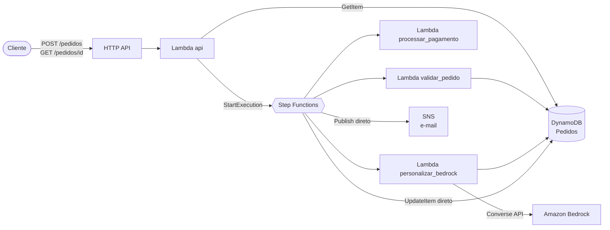
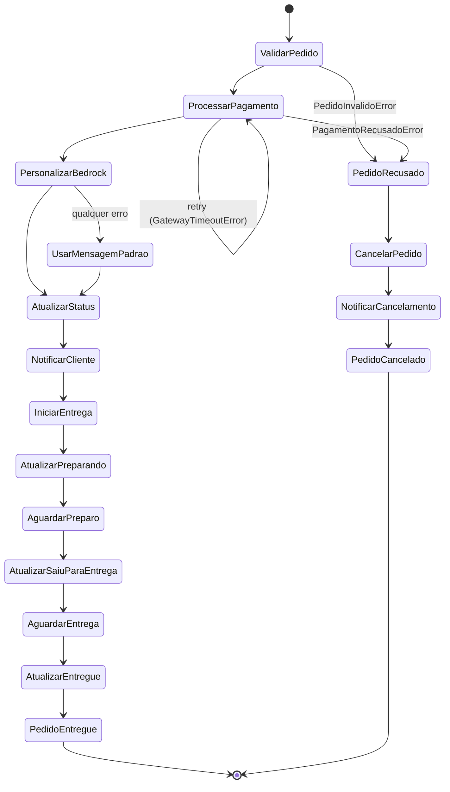

# Arquitetura

## Visão geral

## Máquina de estados

## O que cada estado faz

| Estado | Tipo | O que faz | Onde guarda o resultado |
|---|---|---|---|
| ValidarPedido | Lambda | Grava `RECEBIDO`, valida os campos, calcula o total e marca `VALIDADO` | `$.validacao` |
| ProcessarPagamento | Lambda | Gateway simulado pelo token do pagamento | `$.pagamento_resultado` |
| PersonalizarBedrock | Lambda | Gera mensagem e sugestões com o Bedrock (com fallback) | `$.personalizacao` |
| UsarMensagemPadrao | Pass | Mensagem fixa se a Lambda do Bedrock falhar de vez | `$.personalizacao` |
| AtualizarStatus | DynamoDB direto | Status `PAGO` + `transacao_id` | descartado |
| NotificarCliente | SNS direto | E-mail com a mensagem personalizada e o total | descartado |
| IniciarEntrega | Pass | Converte o parâmetro `WaitSegundos` em número | `$.entrega` |
| Atualizar* / Aguardar* | DynamoDB direto / Wait | `PREPARANDO` → `SAIU_PARA_ENTREGA` → `ENTREGUE` | descartado |
| PedidoRecusado | Pass | Converte o `Cause` do erro (texto JSON) em objeto | `$.erro` |
| CancelarPedido | DynamoDB direto | Status `CANCELADO` + motivo | descartado |
| NotificarCancelamento | SNS direto | E-mail avisando o motivo | descartado |
| PedidoCancelado | Fail | Termina com o tipo do erro de negócio | — |

Todo estado usa `ResultPath`, então o payload original do pedido chega intacto até o fim da execução.

## Tratamento de erros

| Erro | Onde | O que acontece |
|---|---|---|
| `Lambda.ServiceException`, `Lambda.TooManyRequestsException`, `ThrottlingException` | Lambdas | Retry com backoff exponencial (2s, 4s, 8s) |
| `GatewayTimeoutError` | ProcessarPagamento | Mesmo retry; se esgotar, cancela o pedido |
| `PedidoInvalidoError` | ValidarPedido | Catch → cancela o pedido |
| `PagamentoRecusadoError` | ProcessarPagamento | Catch → cancela o pedido |
| Falha do Bedrock ou JSON inválido | PersonalizarBedrock | Fallback dentro da Lambda, pedido segue |
| Falha da própria Lambda do Bedrock | PersonalizarBedrock | Catch `States.ALL` → mensagem padrão, pedido segue |

## Modelo de dados (tabela `Pedidos`)

| Atributo | Exemplo |
|---|---|
| `pedido_id` (PK) | `7b1e6c0a-...` |
| `status` | `RECEBIDO`, `VALIDADO`, `PAGO`, `PREPARANDO`, `SAIU_PARA_ENTREGA`, `ENTREGUE`, `CANCELADO` |
| `cliente`, `itens`, `endereco` | cópia do payload de entrada |
| `total` | `78.90` (Decimal) |
| `transacao_id` | `txn_4f9a1c2b3d4e` |
| `mensagem_personalizada`, `sugestoes` | gerados pelo Bedrock |
| `motivo_cancelamento` | só em pedidos cancelados |
| `historico_status` | `[{"status": "RECEBIDO", "em": "2026-11-06T21:00:00+00:00"}, ...]` |
| `criado_em`, `atualizado_em` | ISO 8601 |
